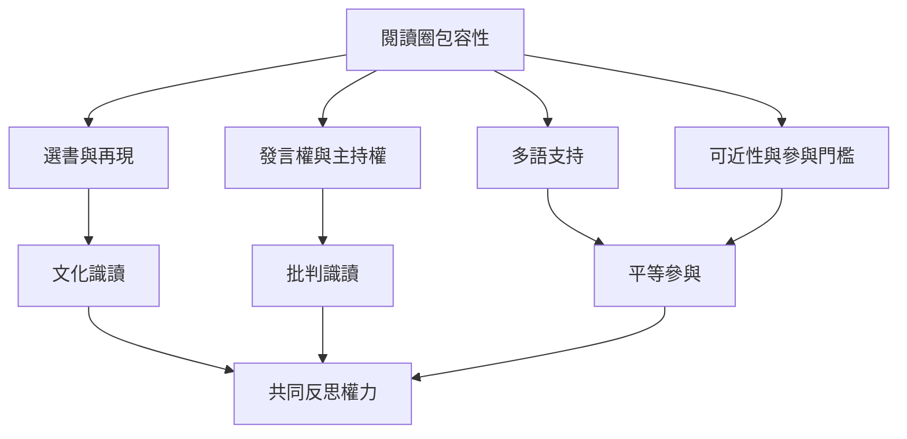

本圖追問誰能加入、誰能發言、誰的文本被選擇，以及誰承擔主持與翻譯勞動。文化多樣性、批判識讀與多語支持需要落實在選書、規則、發言方式與資源安排中，而不只是增加幾本不同背景的書。

核心筆記：[[閱讀社群能成為被排除者練習公共發言的空間]]、[[多語閱讀圈應把語言差異視為資源而非缺陷]]、[[文化多樣性不只是增加書目而是調整誰能定義問題]]。

## Mermaid 關係圖

## 參考
* [[Critical_Literacy]]、[[Cultural_Literacy]]、[[Multilingualism]]、[[Student_Agency]]、[[Dialogic_Learning]]
* [[非裔美國文學社團把閱讀對話轉化為公民參與]]、[[美國女性社團以共讀與寫作累積文化行動能力]]、[[美國女性讀書會是日常閱讀與社會位置反思的場所]]

---
回到主題：[[Literature_circle]]
