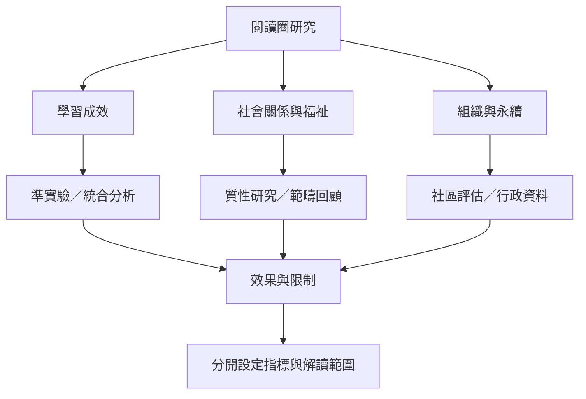

閱讀圈有不同類型的研究證據：第二語言閱讀理解的準實驗與統合分析、成人 Shared Reading 的範疇性回顧、質性訪談、圖書館組織報告與歷史檔案。它們回答的問題不同，不能把學習成效、參與者感受、組織觸及量與臨床療效混為一談。

核心筆記：[[閱讀圈的評估必須區分學習關係與福祉指標]]、[[共讀的社會支持價值不等於已有充分臨床療效證據]]、[[閱讀圈的持續性取決於照顧組織勞動與參與者負擔]]。

## Mermaid 關係圖

## 參考
* [[2025年統合分析支持文學圈可能提升第二語言閱讀理解]]、[[成人共讀的健康研究顯示社群感可能重要但證據仍有限]]、[[日本成人讀書會研究揭示共讀文本如何成為對話共同基準]]
* [[2025年統合分析支持文學圈可能提升第二語言閱讀理解]]、[[閱讀圈的評估必須區分學習關係與福祉指標]]、[[Reading_Engagement]]、[[Reading_Motivation]]

---
回到主題：[[Literature_circle]]
