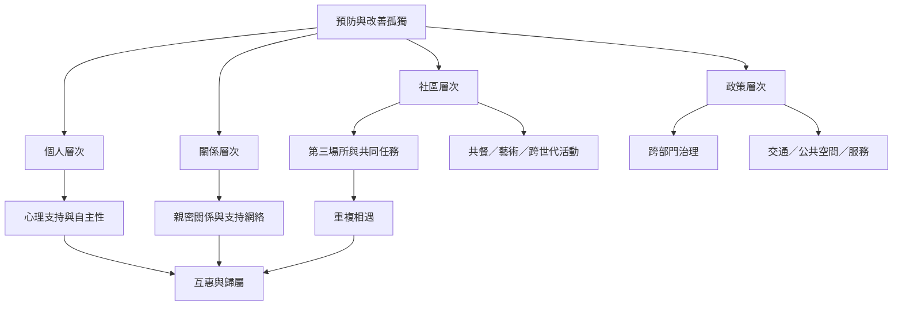

改善孤獨需要把個人支持、關係媒合、共同活動、社區空間與政策資源連接起來。好的介入不強迫社交，而是增加安全、互惠、可重複且符合需求的連結機會。

## 主要連結
* [[預防孤獨需要同時改善個人關係與社會條件]]
* [[孤獨介入應依關係缺口與生活情境量身配對]]
* [[社會基礎設施能提供低門檻且重複相遇的機會]]
* [[用關係需求地圖取代社交人數排行榜]]
* [[社會處方]]、[[第三場所]]、[[社會基礎設施]]、[[互惠]]、[[社區發展]]、[[社區照顧]]

回到主題：[[Loneliness]]。
