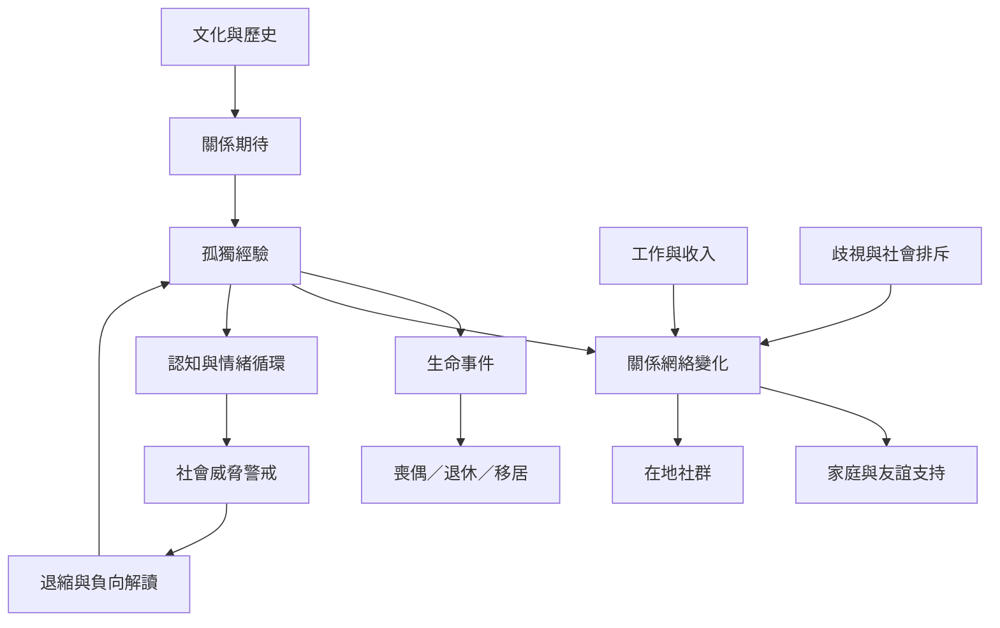

孤獨不是單一原因造成，而是生命事件、關係期待、身心健康、工作制度、遷移經驗、歷史排斥與文化語言交織的結果。此圖把個人、關係與結構因素放在同一脈絡中。

## 主要連結
* [[孤獨的定義會隨文化與歷史脈絡而改變]]
* [[遷移造成的孤獨源於舊網絡中斷與新網絡難以建立]]
* [[地方歸屬與集體記憶是社會連結的重要基礎]]
* [[孤獨可能形成警戒增加與關係退縮的自我強化循環]]
* [[移民]]、[[社會排斥]]、[[地方依附]]、[[集體記憶]]、[[社會網絡]]

回到主題：[[Loneliness]]。
