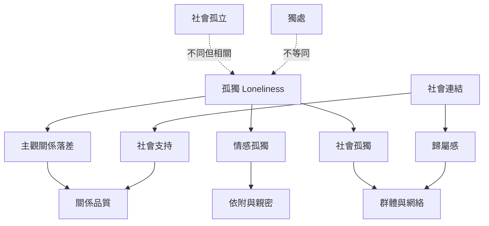

孤獨研究需要先把主觀感受、客觀網絡、獨處與社會連結分開，再理解各種關係缺口如何交織。此圖從個人感受連到不同維度與可測量概念。

## 主要連結
* [[孤獨是主觀關係落差而非單純缺少人際接觸]]
* [[情感孤獨與社會孤獨需要不同的連結方式]]
* [[自主獨處與非自願隔離需要被清楚區分]]
* [[孤獨與社會孤立都和死亡風險相關但觀察研究不能證明單一因果]]
* [[孤獨]]、[[社會孤立]]、[[獨處]]、[[情感孤獨]]、[[社會孤獨]]、[[社會連結]]、[[歸屬感]]

回到主題：[[Loneliness]]。
