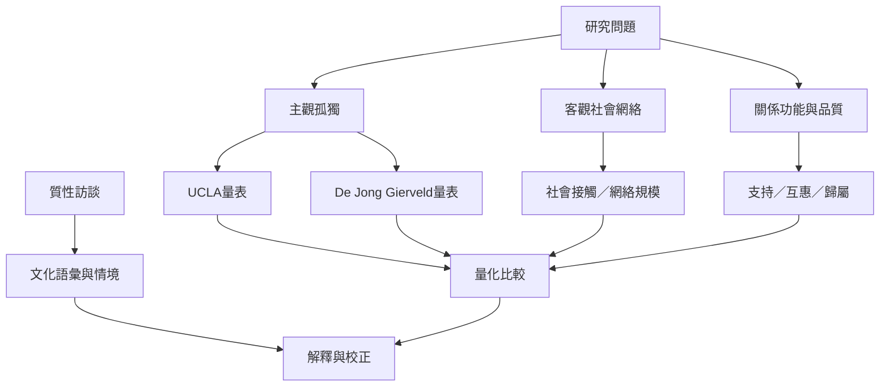

孤獨研究結合主觀量表、社會網絡指標、質性訪談與健康資料。不同方法回答不同問題，不能把單一總分當成完整社會健康指標。

## 主要連結
* [[孤獨的盛行率不能脫離測量方式與文化脈絡比較]]
* [[UCLA孤獨量表讓主觀孤獨經驗得以進行標準化研究]]
* [[De Jong Gierveld量表把孤獨拆成情感與社會兩個維度]]
* [[社會孤立與孤獨是不同但都重要的健康風險]]
* [[孤獨]]、[[社會孤立]]、[[社會網絡]]、[[社會支持]]、[[社會資本]]

回到主題：[[Loneliness]]。
