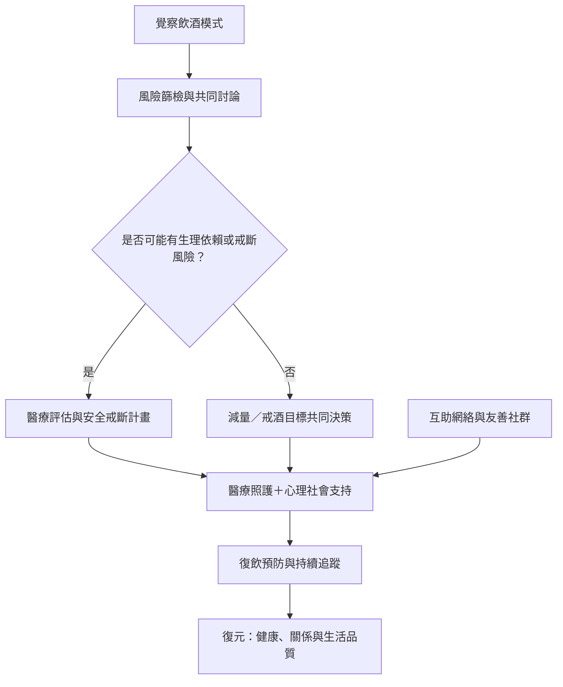

減少酒精傷害可由個人自我觀察、社交環境調整、臨床篩檢、心理社會介入、藥物治療與人口政策多層次組成。對已有生理依賴者，戒斷安全評估應先於自行停止飲酒。恢復並非單一路徑，也不應以羞辱作為動力。

重要提醒：中重度依賴者不可自行突然停酒；嚴重顫抖、幻覺、混亂或抽搐應立即就醫。資料依據：[[酒精戒斷的醫療安全指引]]、[[WHO_mhGAP_酒精依賴整合治療_2023]]、[[Powell_戒酒後認知功能恢復系統性回顧_2024]]。延伸：[[打造友善且不羞辱的飲酒對話]]、[[以互助及照護網絡支援恢復]]。
