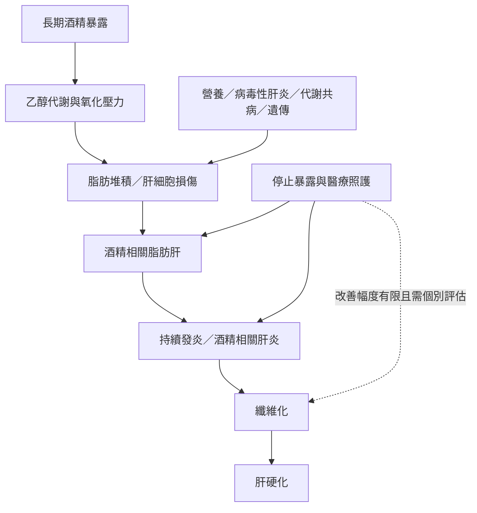

酒精相關肝病並非單一診斷，而是由脂肪堆積、發炎、纖維化到肝硬化的連續譜。乙醇暴露量、飲酒模式、營養狀況、性別、遺傳、病毒性肝炎與代謝共病會共同改變疾病進展。部分早期變化較可逆，晚期結構破壞則可能難以恢復。

閱讀路徑：[[飲酒造成的肝損傷呈連續譜且部分可逆]] → [[NHS_酒精相關肝病階段與恢復]] → [[NIAAA_酒精對全身影響_2026]]。延伸概念：[[酒精相關肝病]]、[[肝纖維化]]、[[肝硬化]]、[[戒酒]]。
