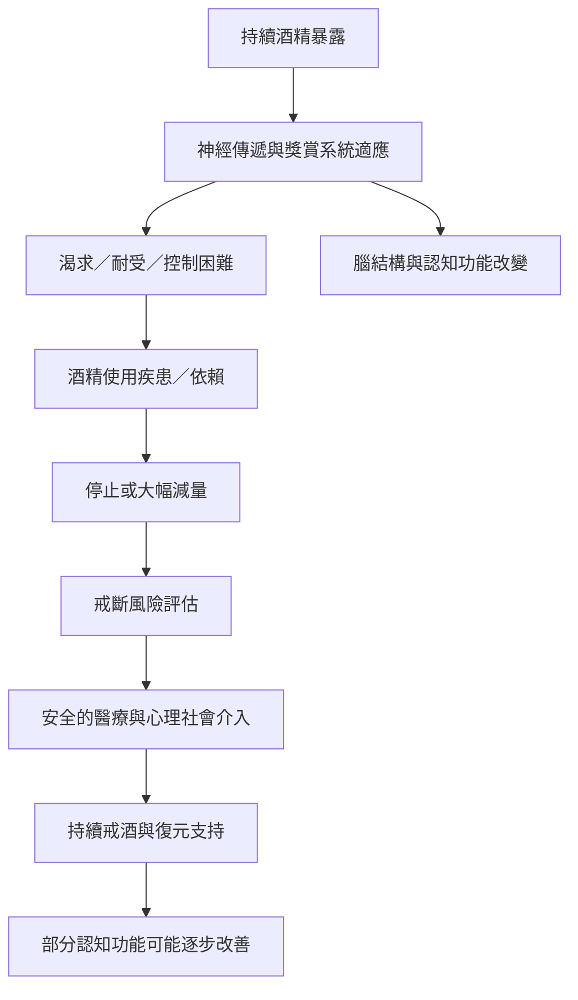

酒精的中樞神經作用與依賴形成，涉及抑制／興奮性神經傳遞、獎賞與壓力系統調節。長期重度飲酒可能影響腦結構與認知功能；戒酒後部分功能可恢復，但恢復速度與程度具有個體差異。依賴者若突然停酒，還可能出現嚴重戒斷。

閱讀路徑：[[酒精依賴是可治療的健康問題而不是道德缺陷]] → [[酒精戒斷的醫療安全指引]] → [[停止飲酒後部分神經認知能力有恢復可能]]。相關研究：[[NIAAA_酒精對全身影響_2026]]、[[Powell_戒酒後認知功能恢復系統性回顧_2024]]、[[WHO_mhGAP_酒精依賴整合治療_2023]]。
