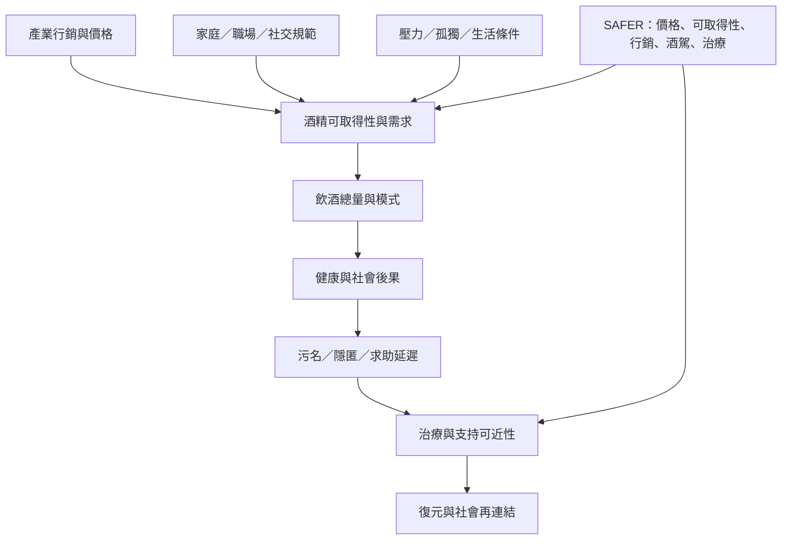

酒精暴露並非單純個人選擇的結果。市場、價格、廣告、販售密度、家庭與職場文化、社交規範及治療資源，共同形塑飲酒環境。政策與服務若只針對個人勸告，可能忽略結構性因素與商業健康決定因素。

延伸閱讀：[[飲酒的社會常態化會延遲問題辨識]]、[[飲酒風險不會只由個人意志與知識決定]]、[[降低酒精傷害需要個人服務與結構政策]]。資料依據：[[WHO_SAFER_全球酒精政策執行進展_2026]]、[[IARC_酒精政策手冊_2025]]、[[AUD_正常化飲酒與問題辨識訪談_2026]]與[[Women_Shame_Recovery_Narrative_2024]]。
