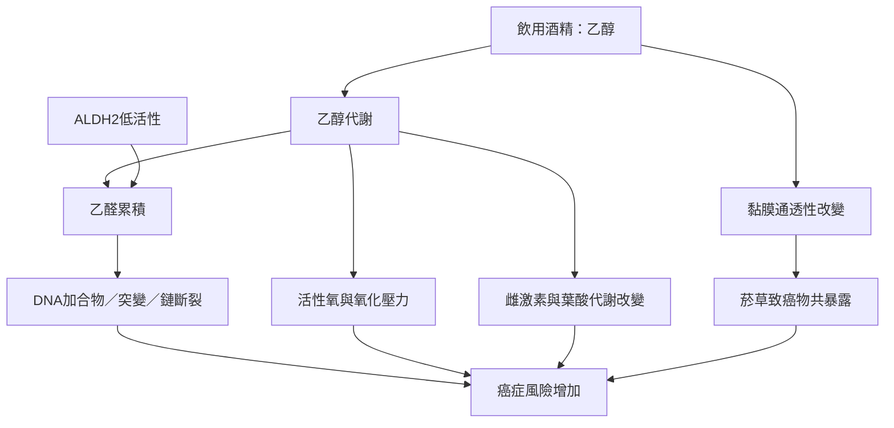

此圖聚焦乙醇如何透過乙醛、DNA 損傷、氧化壓力、荷爾蒙與共同暴露影響癌症風險。IARC 已建立酒精與多個癌症部位的因果關係；不同機制的貢獻會因器官、基因及共同暴露而異。

概念延伸：[[乙醇]]、[[乙醛]]、[[ALDH2]]、[[致癌物]]、[[相對風險]]。核心文獻為[[IARC_酒精與癌症因果關係]]、[[NCI_酒精致癌機制]]、[[China_Kadoorie_Biobank_ALDH2_食道癌_2018]]與[[Taiwan_上消化呼吸道癌症酒檳菸世代研究_2014]]。
