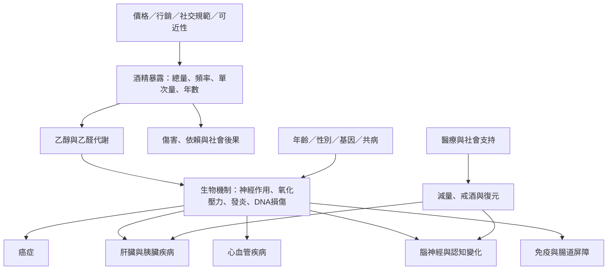

本圖譜把酒精長期影響視為多器官、多層次的風險網絡。乙醇暴露經由代謝、神經作用、發炎與行為改變，連結癌症、肝病、心血管、腦神經、免疫、睡眠與心理健康；暴露的結果又受到年齡、性別、基因、社會條件與共病調節。

閱讀路徑：先讀[[酒精是具有依賴性的精神活性物質而非單純飲料]]與[[酒精長期風險同時取決於累積量與飲酒模式]]，再依器官系統展開[[乙醇與乙醛可透過多條生物路徑增加癌變可能]]、[[飲酒造成的肝損傷呈連續譜且部分可逆]]、[[長期重度飲酒會改變腦結構與認知功能]]及[[酒精與心血管疾病的J形曲線需要因果推論上的謹慎]]。全球資料見[[WHO_酒精與健康全球現況_2024]]與[[GBD_2020酒精風險跨國劑量反應_2022]]。
