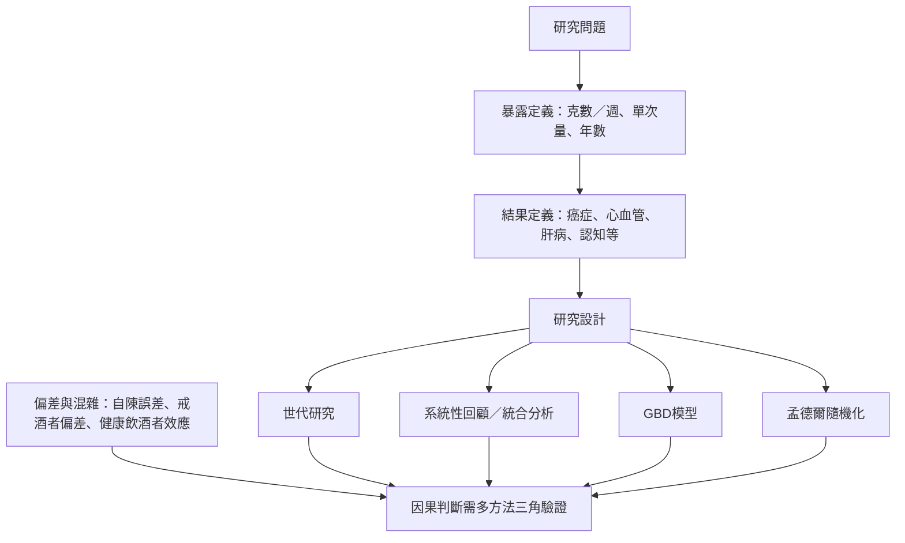

酒精研究常使用觀察性世代、病例對照、系統性回顧、模型估計與遺傳工具變項。不同方法回答不同問題；研究中的標準杯、參照組、飲酒史測量、病後戒酒者與混雜控制，都可能改變結果。特別需要避免將人口層級的模型最低風險點解讀成個人健康建議。

閱讀路徑：[[不同國家的標準杯不是同一個酒精重量]] → [[酒精與心血管疾病的J形曲線需要因果推論上的謹慎]] → [[GBD_2020酒精風險跨國劑量反應_2022]]。概念工具：[[劑量反應關係]]、[[相對風險]]、[[J形曲線]]、[[戒酒者偏差]]、[[混雜因子]]、[[孟德爾隨機化]]。
