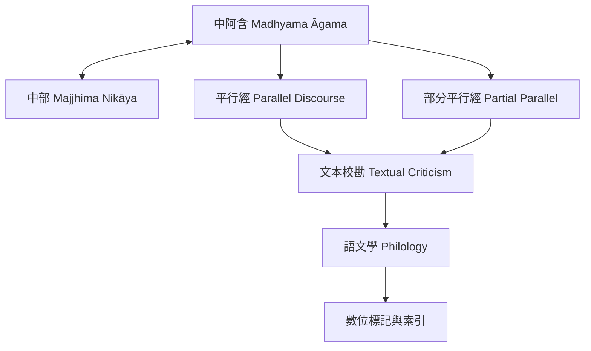

這張地圖聚焦不同經集、語言版本與數位工具之間的對讀。[[阿含經 Āgama]] 與 [[尼柯耶 Nikāya]] 是經集層級的概念；[[中阿含 Madhyama Āgama]] 與 [[中部 Majjhima Nikāya]] 是具體經集；[[平行經 Parallel Discourse]] 與 [[部分平行經 Partial Parallel]] 描述文本關係。研究者透過 [[文本校勘 Textual Criticism]]、[[語文學 Philology]] 及電子標記，將比較判斷變得透明。

主要文獻：[[釋明洲以漢譯中阿含與巴利中部建立早期比較研究基礎]]、[[無著比丘的跨經比較讓中阿含成為早期佛教研究的重要材料]]、[[蘇錦坤提醒平行經與部分平行經必須有判準]]、[[SuttaCentral 的中阿含平行經索引連接多部經藏]]、[[台灣數位佛典研究已把阿含比較帶入電子標記方法]]。

可操作的延伸：[[建立一張跨語言平行經比較表]]、[[把研究資料建成可追溯的文本關係圖]]、[[為傳承爭議建立證據與不確定性清單]]、[[101]]。
