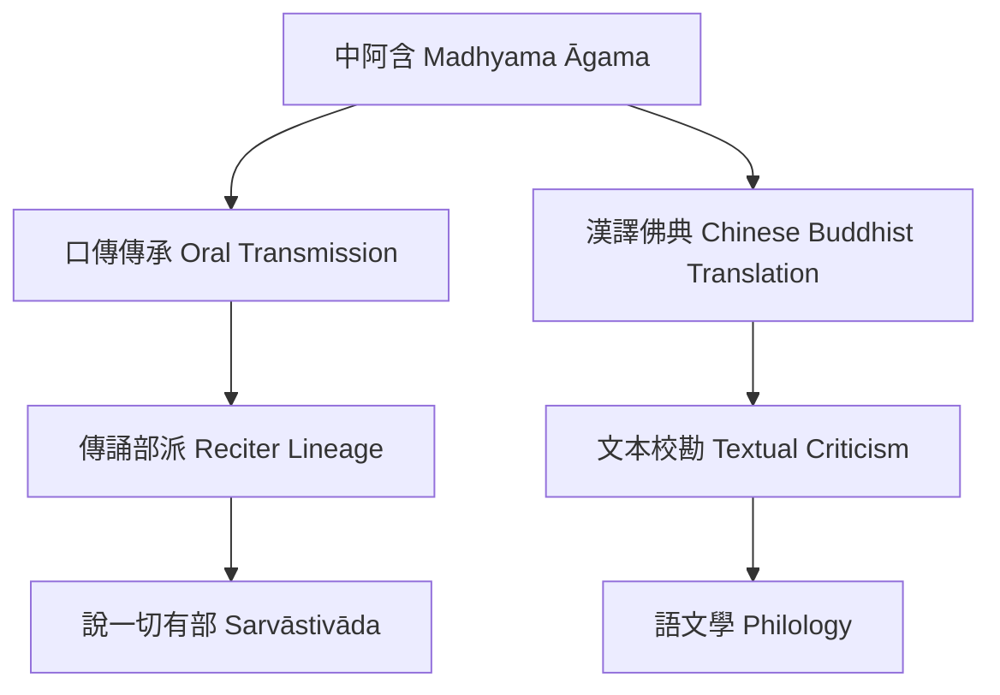

本概念地圖以文本如何形成、傳持、翻譯與被分類為中心。先從 [[中阿含 Madhyama Āgama]] 的現存漢譯定位開始，再沿著 [[口傳傳承 Oral Transmission]]、[[傳誦部派 Reciter Lineage]] 與 [[說一切有部 Sarvāstivāda]] 理解其歷史線索。[[文本校勘 Textual Criticism]] 與 [[語文學 Philology]] 則提供辨識異文、翻譯與語言層次的方法。

核心研究入口：[[瞿曇僧伽提婆的東晉譯經記錄]]、[[早期曇摩難提譯本顯示中阿含曾有不同漢譯形態]]、[[中阿含的部派歸屬應以傳誦線索而非單一特徵判斷]]、[[日本梵文殘片研究補足中阿含的印度語系見證]]、[[中阿含相當梵文斷片一覧建立可檢索的殘片索引]]。

進一步閱讀：[[平行經比較與數位研究 MOC]]、[[跨地域學術與翻譯網絡 MOC]]、[[101]]。
