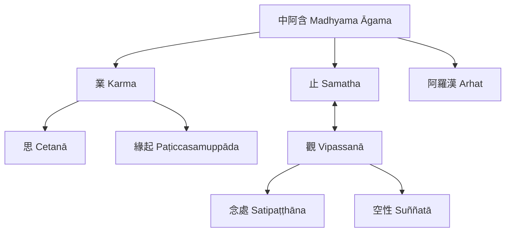

這張地圖連接《中阿含》的教理議題與修行問題。[[業 Karma]] 與 [[思 Cetanā]] 關係密切，並可在 [[緣起 Paṭiccasamuppāda]] 的條件脈絡中理解；[[止 Samatha]]、[[觀 Vipassanā]] 與 [[念處 Satipaṭṭhāna]] 涉及禪修架構；[[空性 Suññatā]] 則需要回到早期經文語境，而非直接套用後期形上學。

重要歸納：[[數目編排是中阿含組織教說的記憶技術]]、[[業的討論必須區分行為意向與結果]]、[[止與觀的關係需要放在具體修行語境理解]]、[[空的早期經文用法不能直接等同後期宗派理論]]、[[女性修行與出家制度史應以跨版本材料檢視]]。

延伸行動：[[為每次經文閱讀保留一個可追溯的問題]]、[[以經文問題設計低門檻共讀與觀察]]、[[101]]。
