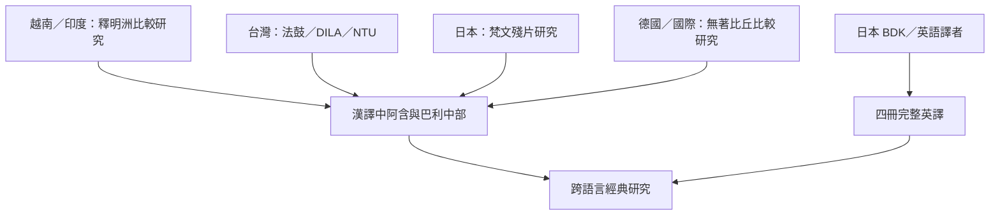

《中阿含》的現代研究不是單一國家或語言的成果。越南佛教學者釋明洲以漢巴比較建立重要先例；台灣的法鼓文化、台大佛學數位圖書館與 DILA 數位典藏推進研究與文本整理；日本研究者松田和信、鄭鎮一與吹田隆道處理梵文殘片；德國學界的無著比丘以多語言平行經從事文本與教理研究；日本 BDK 與英語研究者合作完成四冊英譯。

文獻入口：[[釋明洲以漢譯中阿含與巴利中部建立早期比較研究基礎]]、[[無著比丘的中阿含研究以平行經檢視傳承差異]]、[[日本梵文殘片研究補足中阿含的印度語系見證]]、[[中阿含相當梵文斷片一覧建立可檢索的殘片索引]]、[[BDK 四冊英譯讓二百二十二經有完整英語入口]]。

這張地圖刻意區分研究者任職地、出版地、語言與材料收藏地；跨國合作不應被簡化為國籍分類。後續可補入南亞、東南亞與東亞的第一手修行者訪談，但需另外設計訪談倫理與樣本方法。參見 [[建立跨地區中阿含研究者與譯本地圖]]、[[文本研究與當代修行經驗互補但不能互相取代]]、[[101]]。
