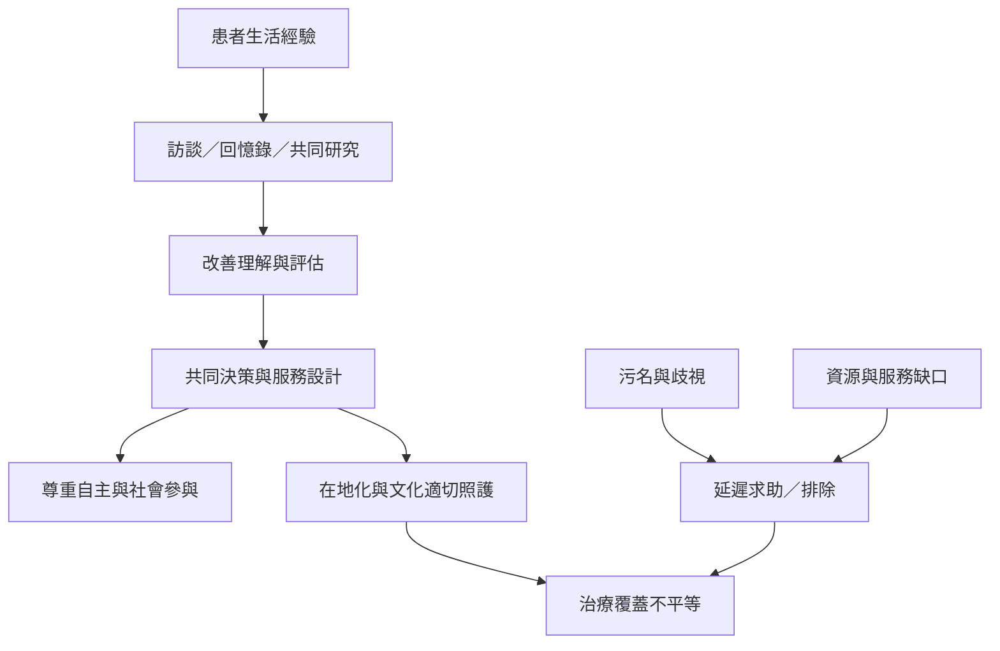

本圖聚焦患者如何描述憂鬱，以及這些描述如何影響研究、照護、文化理解與政策。患者經驗需要參與知識共創；全球照護公平則要求我們看見服務覆蓋、污名、資源差距與在地化。

概念連結：[[Lived experience]]、[[Peer support]]、[[Stigma]]、[[Social determinants of mental health]]、[[Task sharing]]、[[Shared decision-making]]。

相關永久筆記：[[第一人稱經驗補足診斷分類無法完整呈現的生活世界]]、[[污名會把健康困境轉化為延遲求助與社會排除]]、[[跨文化評估應從當事人的語言與生活脈絡開始]]、[[社會條件會影響憂鬱風險與取得照護的機會]]。

文獻依據：[[患者與研究者共同回顧指出憂鬱會改變身體自我與時間經驗]]、[[全球重鬱症治療覆蓋率偏低顯示照護落差是制度問題]]、[[印度2026年憂鬱症臨床指引嘗試結合國際證據與在地照護]]。

---

回到全書：[[major_depressive_disorder|重鬱症知識書導讀]]。
