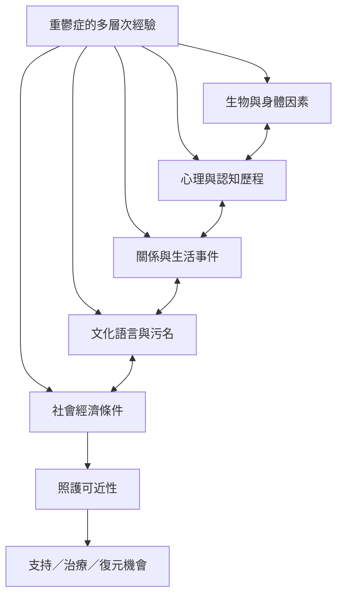

此地圖將憂鬱症放在生物、心理、關係、文化與社會結構的交互作用中理解。任何單一層次都不足以代表全部病因；風險、保護因素與服務障礙也會隨時間及地區變化。

概念連結：[[Major depressive disorder]]、[[Somatic symptoms]]、[[Depressive cognition]]、[[Social determinants of mental health]]、[[Stigma]]、[[Lived experience]]。

相關永久筆記：[[重鬱症是多層次交互作用而非單一化學失衡]]、[[社會條件會影響憂鬱風險與取得照護的機會]]、[[污名會把健康困境轉化為延遲求助與社會排除]]、[[第一人稱經驗補足診斷分類無法完整呈現的生活世界]]。

文獻依據：[[生物標記研究尚未提供可常規診斷重鬱症的單一檢驗]]、[[社經地位系統性回顧發現低社經條件與憂鬱風險相關]]、[[非洲精神疾病污名質性回顧指出社會排斥會阻礙照護]]。

---

回到全書：[[major_depressive_disorder|重鬱症知識書導讀]]。
