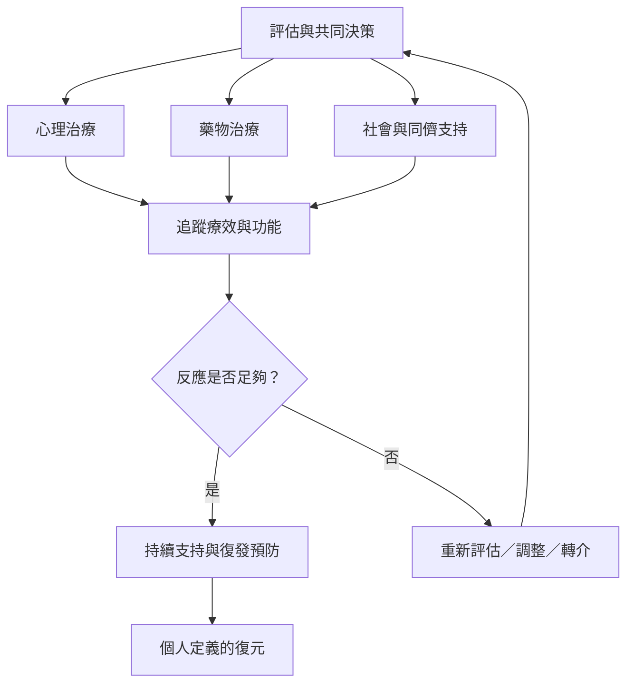

這張地圖把治療視為一段可共同決策、持續追蹤與調整的歷程。心理治療、藥物、支持與社區服務可能互補；緩解、功能恢復與個人復元需要分別追蹤。

概念連結：[[Shared decision-making]]、[[Behavioral activation]]、[[Cognitive behavioral therapy]]、[[Interpersonal psychotherapy]]、[[Antidepressants]]、[[Remission]]、[[Relapse and recurrence]]、[[Treatment-resistant depression]]、[[Peer support]]、[[Task sharing]]。

相關永久筆記：[[治療選擇應由證據偏好與資源條件共同決定]]、[[心理治療藥物與社會支持是可協調的照護工具]]、[[緩解不等於復元而復發預防需要持續規劃]]、[[支持者的角色是同行與轉介而不是要求當事人振作]]。

文獻依據：[[NICE成人憂鬱症指引強調分層照護與共同決策]]、[[WHO_mhGAP將心理治療列為中重度憂鬱的重要照護方案]]、[[CANMAT成人重鬱症指引呈現心理治療與藥物治療的組合價值]]。

---

回到全書：[[major_depressive_disorder|重鬱症知識書導讀]]。
