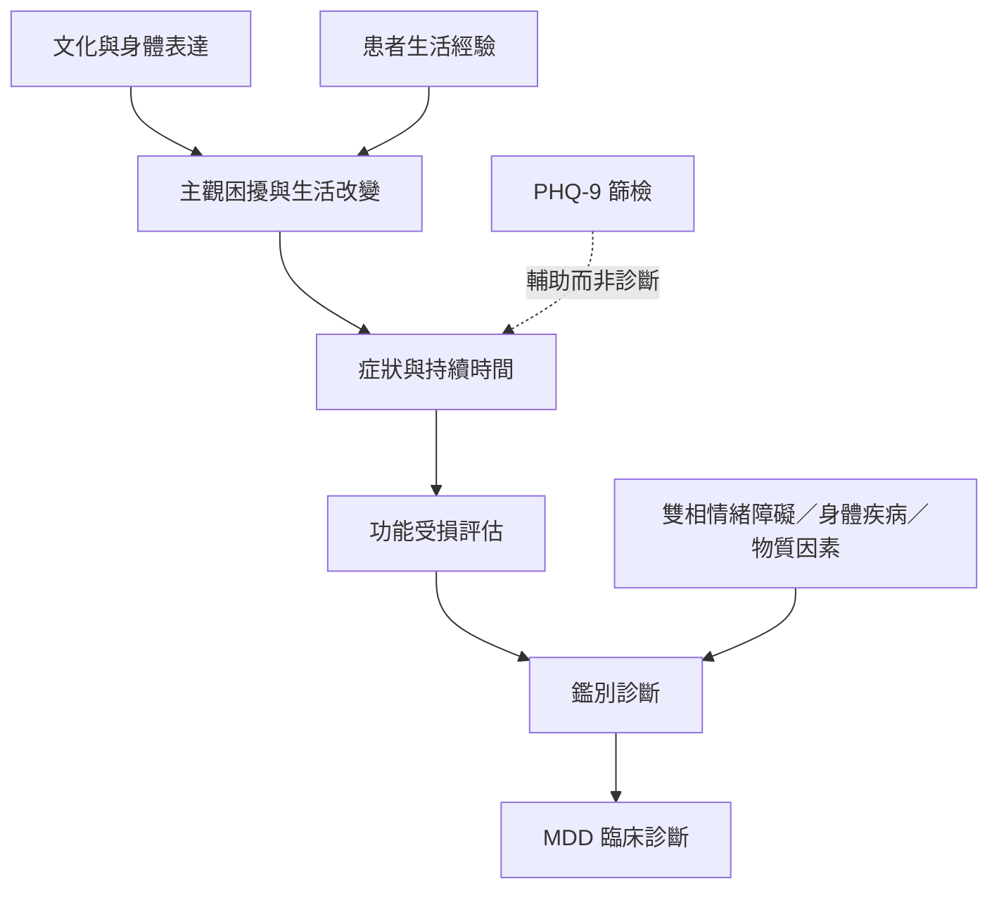

這張地圖整理診斷分類如何將主觀痛苦轉化為可溝通的臨床語言，同時標示鑑別診斷、篩檢工具與經驗敘事的邊界。從症狀組合與功能影響開始，接著理解快感缺失、身體表現與跨文化差異。

概念連結：[[Major depressive disorder]]、[[Major depressive episode]]、[[Anhedonia]]、[[PHQ-9]]、[[Bipolar disorder]]、[[Differential diagnosis]]、[[Somatic symptoms]]、[[Lived experience]]。

相關永久筆記：[[重鬱症不是悲傷的同義詞而是涉及持續症狀與功能受損的臨床綜合徵]]、[[快感缺失提醒我們憂鬱不一定表現為哭泣或明顯悲傷]]、[[診斷標準提供共同語言卻不能完整描述個人的痛苦]]、[[身體症狀是憂鬱經驗的一部分而非不真實的心理替代品]]、[[跨文化評估應從當事人的語言與生活脈絡開始]]。

文獻依據：[[DSM診斷準則以症狀組合功能損害與排除條件界定重鬱症]]、[[中國患者訪談顯示憂鬱可能透過多樣身體症狀表達]]、[[跨文化研究顯示憂鬱的表達差異不能化約為刻板印象]]。

---

回到全書：[[major_depressive_disorder|重鬱症知識書導讀]]。
