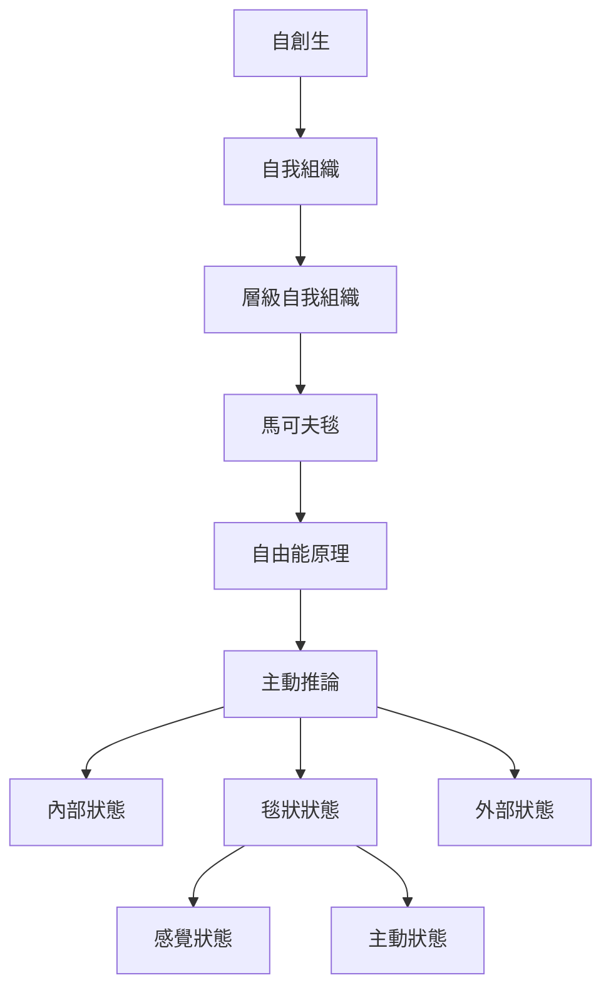

這張地圖呈現馬可夫毯如何從統計工具延伸到生命、腦與環境的互動模型。[[自由能原理]]與[[主動推論]]把系統表示為[[內部狀態]]、[[外部狀態]]與[[毯狀狀態]]；毯狀狀態可再分為[[感覺狀態]]與[[主動狀態]]。這一路徑可與[[自創生]]、[[自我組織]]及[[層級自我組織]]對話，但需持續檢查形式推論與本體論主張之間的距離。

## 思與行
* 每讀一個生命系統案例，先列出系統尺度與狀態分組，再討論自主性或個體性。
* 把物理膜、受體、行動器官視為可能的實現機制，不把它們與抽象毯狀變項直接畫上等號。

## 參考
* 核心辨析：[[馬可夫毯首先是條件獨立關係而不是物理牆]]、[[內部狀態與外部狀態是模型中的相對位置]]、[[感覺狀態與主動狀態分別形成輸入和輸出的介面]]。
* 概念：[[主動推論]]、[[自由能原理]]、[[變分自由能]]、[[內部狀態]]、[[外部狀態]]、[[毯狀狀態]]、[[感覺狀態]]、[[主動狀態]]、[[自創生]]、[[自我組織]]、[[層級自我組織]]。
