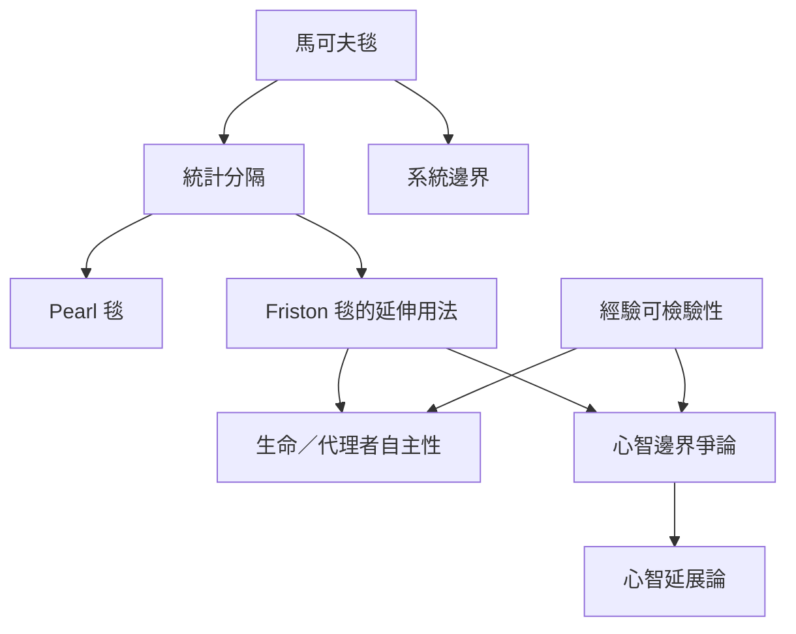

這張地圖整理馬可夫毯跨入生命哲學、心智哲學與系統論時的爭議。[[系統邊界]]與[[馬可夫毯]]可以幫助研究者明確描述內外關係；但從統計分隔到生命個體或心智的本體邊界，還需要額外前提。[[心智延展論]]尤其提醒認知活動可能跨越腦、身體、工具及環境。

## 思與行
* 讀跨領域論述時，將定義、數學假設、經驗資料及本體論結論分開標記。
* 對社群、身體或心智的比喻性應用，先提出可被反駁的操作化問題，避免把模型當成答案。

## 參考
* 核心筆記：[[Pearl 毯與 Friston 毯回答不同層次的問題]]、[[統計分隔本身不足以證成心智或生命的本體邊界]]、[[馬可夫毯首先是條件獨立關係而不是物理牆]]。
* 概念：[[心智延展論]]、[[系統邊界]]、[[理論的經驗可檢驗性]]、[[自創生]]、[[自由能原理]]。
