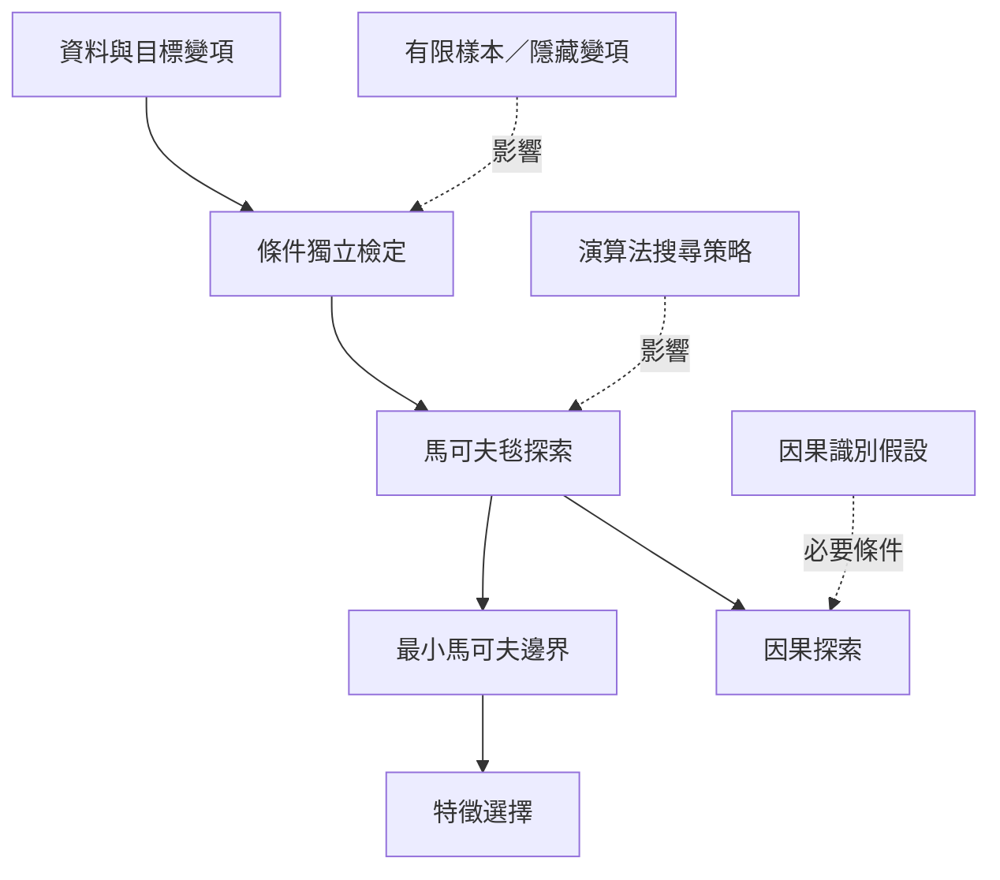

此圖整理馬可夫毯在機器學習及因果探索中的實務角色。從[[條件獨立]]與目標節點的局部結構，估計[[馬可夫邊界]]，再將其用於[[特徵選擇]]或[[因果探索]]。必須注意：特徵邊界可以提供預測上的局部充分性，但不自動形成完整因果解釋；搜尋結果也會受樣本與檢定程序影響。

## 思與行
* 評估演算法時同時看預測效能、邊界穩定性、樣本效率、可解釋性與因果識別條件。
* 比較 HITON、CSMB 等方法時，先核對資料集、條件獨立檢定和基準方法是否可公平比較。

## 參考
* 核心筆記：[[馬可夫毯能縮小預測所需的資訊集合]]、[[預測相關性不能直接當成因果解釋]]、[[有限樣本與隱藏變項會使馬可夫毯探索不穩定]]、[[馬可夫毯探索演算法的品質取決於條件獨立檢定]]。
* 概念：[[特徵選擇]]、[[因果探索]]、[[馬可夫邊界]]、[[條件獨立]]。
