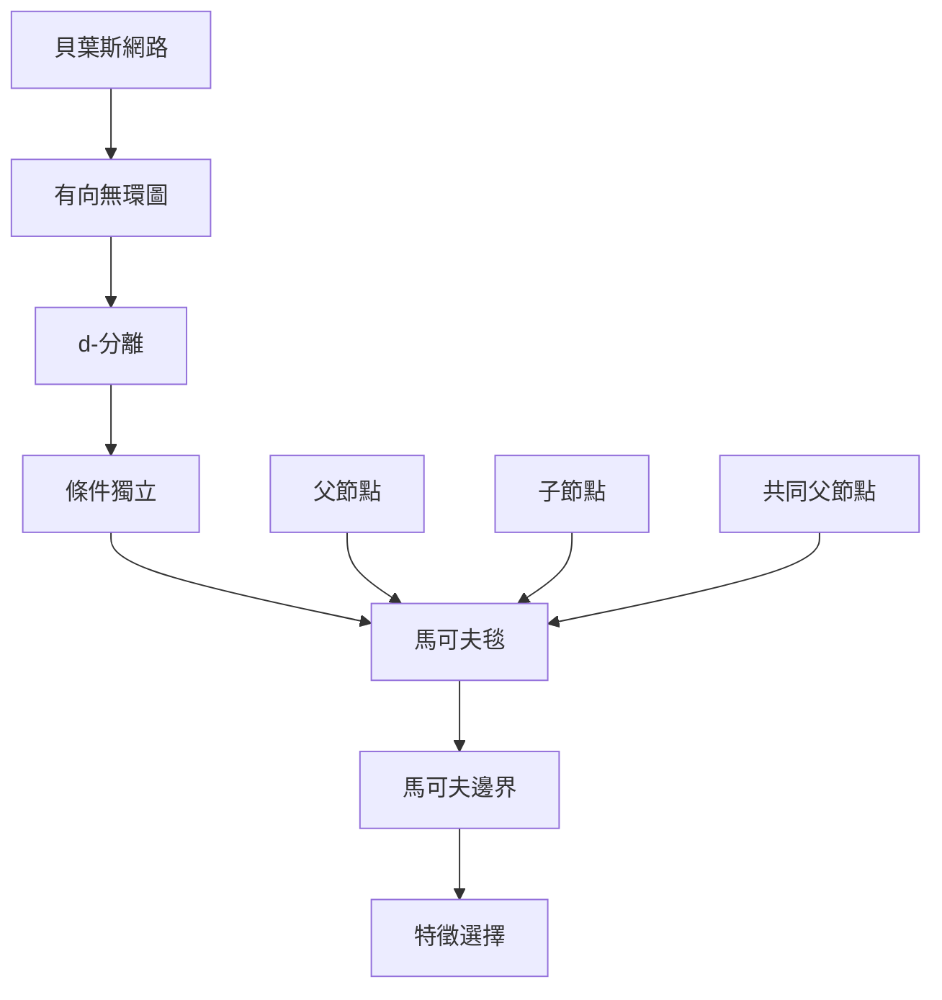

本概念地圖整理馬可夫毯最原始、最穩固的統計語境：如何用圖結構與條件獨立找出一個變項的局部資訊鄰域。核心路徑是從[[貝葉斯網路]]與[[有向無環圖]]出發，使用[[d-分離]]判斷[[條件獨立]]，再由[[父節點]]、[[子節點]]及[[共同父節點]]構成[[馬可夫毯]]。最小化後得到[[馬可夫邊界]]。

## 思與行
* 初學先用三至五個節點畫圖，計算某一節點的父、子與共同父節點，再檢查分隔是否成立。
* 進階再比較一般分布中的最小邊界與 DAG 中的典型結構，不把兩種定義混為一談。

## 參考
* 主要筆記：[[貝葉斯網路中的馬可夫毯由父子與共同父節點構成]]、[[最小馬可夫邊界是目標變項的最小充分預測集合]]。
* 概念：[[馬可夫毯]]、[[馬可夫邊界]]、[[條件獨立]]、[[有向無環圖]]、[[d-分離]]、[[父節點]]、[[子節點]]、[[共同父節點]]。
