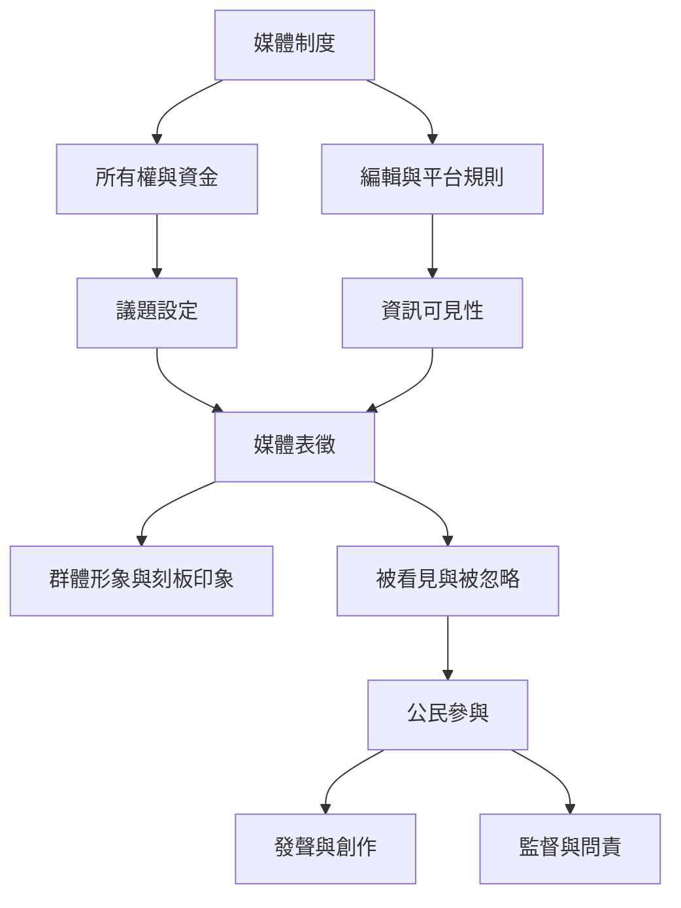

媒體不僅傳遞資訊，也參與建構社會世界、分配可見性與塑造公共議題。批判媒體素養將訊息表徵與媒體所有權、商業模式、語言權利和公民參與放在同一分析框架。

## 雙向連結
* [[批判媒體素養]] · [[媒體表徵]] · [[公共領域]] · [[媒體近用權]] · [[數位公民]]
* [[媒體素養必須追問誰擁有媒體與誰能發聲]] · [[在地語言與邊緣群體發聲是媒體素養的公平基礎]] · [[公共健康資訊環境需要平台政府媒體與公民共責]]
* [[非洲區域合作將媒體資訊素養連結新聞自由與在地語言]] · [[拉丁美洲媒體素養聯盟呈現教育社群媒體研究與受眾權利]]

## 參考
* [[Media_literacy]]
