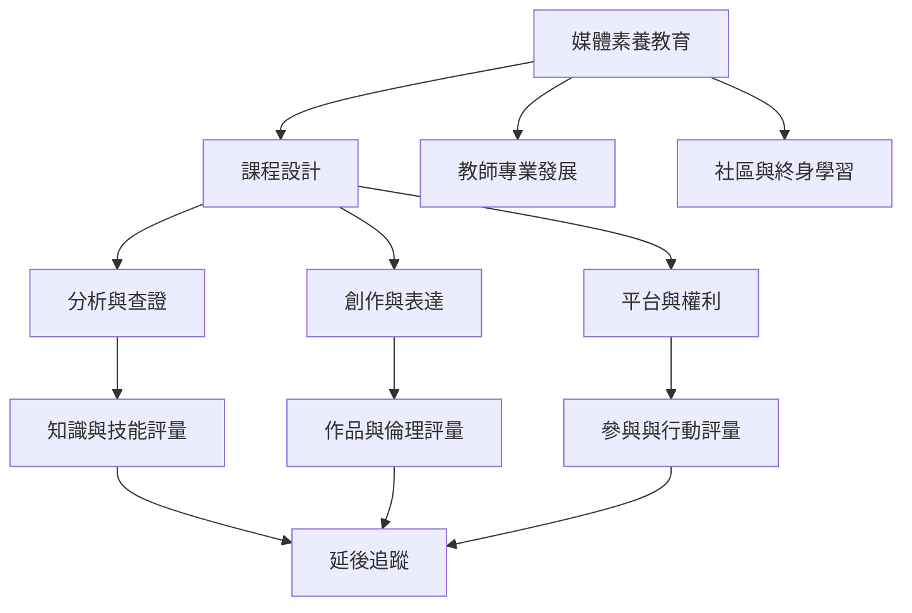

媒體素養教育需要把能力定義轉化成教學活動、教師支持、學習者創作與評量制度。評量時應分辨短期知識、批判信念、查證技能、長期習慣與公共參與。

## 雙向連結
* [[媒體素養]] · [[媒體與資訊素養]] · [[數位素養]] · [[新聞素養]]
* [[批判識讀應以開放探究而非標準答案為核心]] · [[多次課程比一次性宣導更適合培養持久判斷習慣]] · [[媒體素養評量應看知識技能習慣與參與行動]]
* [[芬蘭國家媒體教育政策以全面高品質與系統性為目標]] · [[台灣數位時代媒體素養白皮書提出知情負責利他的數位公民願景]] · [[四十年統合分析顯示媒體素養介入普遍有效但效果異質]]

## 參考
* [[Media_literacy]]
