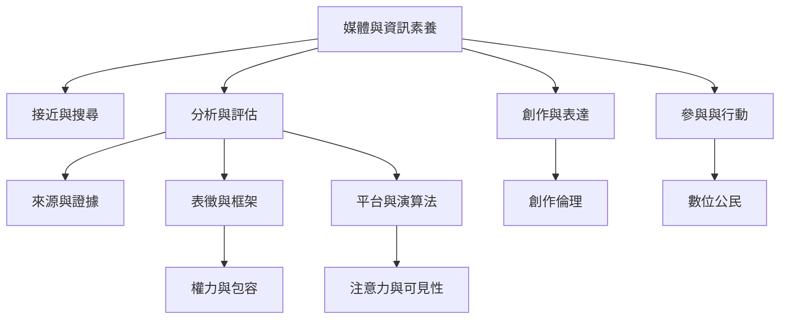

媒體素養是一組讓人們能讀懂、評估、創作與參與媒體環境的能力。整體地圖從核心能力、資訊判斷、媒體制度、數位平台、教育政策與公共行動六個方向組織。

## 雙向連結
* [[媒體素養]] · [[媒體與資訊素養]] · [[資訊素養]] · [[數位素養]] · [[新聞素養]] · [[批判媒體素養]] · [[AI素養]]
* [[媒體素養同時包含讀懂媒體與創作媒體]] · [[媒體訊息是經過選擇與建構的世界版本]] · [[媒體素養必須追問誰擁有媒體與誰能發聲]] · [[媒體素養不能被縮減成假訊息偵測]]
* [[UNESCO媒體與資訊素養課程涵蓋資訊技術表徵公民隱私與AI]] · [[NAMLE媒體素養核心原則將批判分析與表達行動並列]] · [[歐洲理事會數位公民手冊將媒體資訊素養放在線上權利與福祉中]]

## 參考
* [[Media_literacy]]
