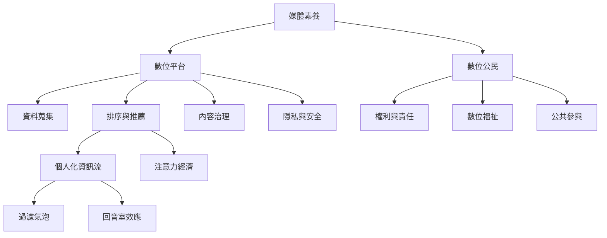

平台透過資料蒐集、排序、推薦與內容治理，塑造資訊可見度和人們的線上生活。數位公民需要理解平台機制，也需要維護隱私、福祉、表達權與參與能力。

## 雙向連結
* [[演算法素養]] · [[過濾氣泡]] · [[回音室效應]] · [[注意力經濟]] · [[數位公民]] · [[數位素養]] · [[AI素養]]
* [[演算法素養要求理解排序與推薦如何塑造可見性]] · [[生成式AI素養需要追查來源與揭露不確定性]] · [[數位接取不等於資訊自主與民主參與]] · [[數位公民教育連結線上生活福祉與權利]]
* [[歐盟DigComp 3.0把AI能力橫向融入數位素養框架]] · [[UNESCO人工智慧時代媒體素養需涵蓋模型權力與人權]]

## 參考
* [[Media_literacy]]
