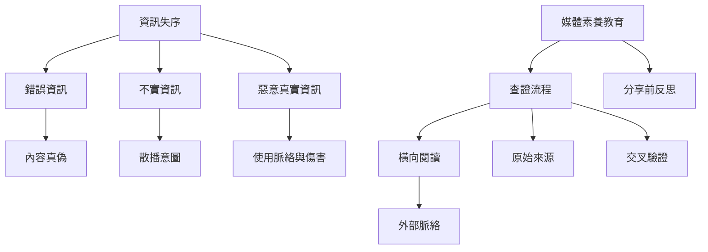

資訊失序需要同時檢視內容是否錯誤、散播者意圖、資訊如何被放大，以及受眾如何理解。事實查核與橫向閱讀是必要方法，但不能取代對制度、情緒與隱私傷害的分析。

## 雙向連結
* [[錯誤資訊]] · [[不實資訊]] · [[惡意真實資訊]] · [[資訊素養]] · [[事實查核]] · [[橫向閱讀]]
* [[查證資訊應先離開原網站進行橫向閱讀]] · [[情緒應成為訊息判讀的訊號而非判斷結論]] · [[媒體辨識訓練有效但行為改變需要情境支持]]
* [[資訊失序報告區分錯誤資訊蓄意操弄與有害真實資訊]] · [[橫向閱讀研究顯示查核者以跨網站脈絡判斷資訊來源]]

## 參考
* [[Media_literacy]]
