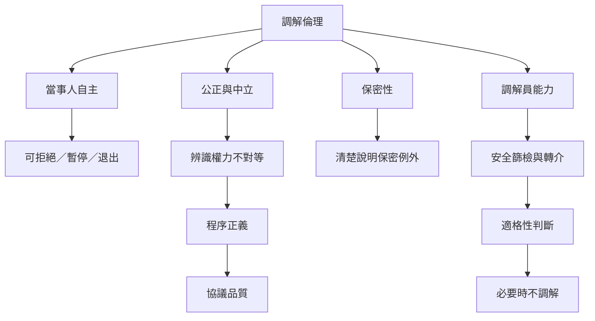

調解倫理的關鍵張力在於：如何在尊重自主、維持公正、保密、效率與安全之間作出負責任的程序選擇。中立不表示忽略資源差距；保密不代表沒有例外；自願不只是簽名；和解率也不足以代表公平。

建議先讀[[調解員中立不能等同於對不平等保持沉默]]、[[自願性必須包括可拒絕可暫停可退出]]與[[保密應有清楚界線而不能被當作絕對保護]]，再讀家事安全與文化適切性資料。這張地圖提醒：程序設計不能只追求快速結案，也要處理退出與轉介。

## 思與行
* 將倫理原則改寫成開案檢核、過程觀察與結案回饋三種工具。
* 定期檢查某些群體是否更常被導入調解、被迫接受協議或在過程中退出。

## 參考
* [[ABA調解員行為標準將自決公正能力與保密列為核心]]。
* [[家事調解需以親密伴侶暴力篩檢守住安全底線]]。
* [[原住民族在地衝突處理策略需要依文化脈絡評估]]。
