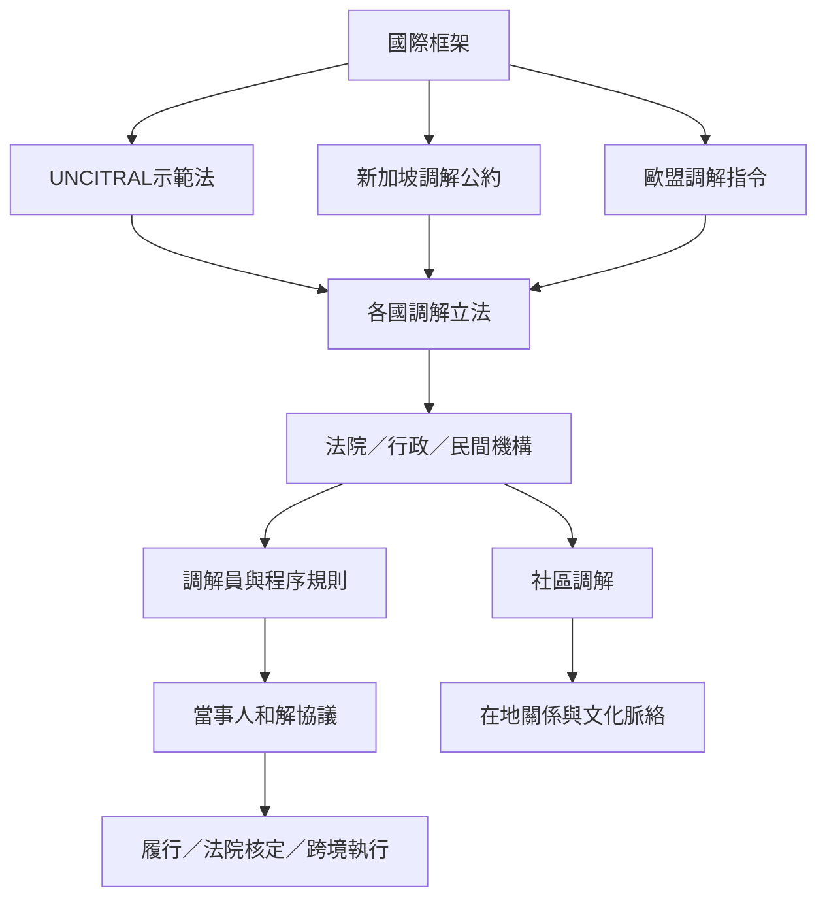

調解制度存在多個治理層次：國際規範提供共同語言與跨境執行工具；各國法律定義可調解案件、程序與協議效力；機構規則處理具體程序；社區與地方制度則連結在地關係與日常爭議。這些層次互相補充，卻不能互相替代。

台灣案例可從[[台灣司法體系以法院行政民間構成多層ADR]]與[[台灣鄉鎮市調解經法院核定後具有判決同等效力]]開始；比較中國、印度、澳洲與國際制度時，閱讀[[中國人民調解制度將社區自治納入正式法律架構]]、[[印度調解法2023納入機構社區與線上調解]]、[[澳洲AMDRAS把調解員認證培訓倫理與申訴整合]]。

## 思與行
* 用同一張制度比較表整理法源、管理機構、調解員資格、保密、協議效力與退出後的救濟。
* 跨境案件須回到具體適用法與官方最新文本，不可由國際標準直接推論所有國家一致。

## 參考
* [[UNCITRAL示範法統一國際商事調解的程序基準]]。
* [[新加坡調解公約為跨境商事和解提供執行框架]]。
* [[跨境商事調解]]、[[替代性爭議解決]]。
