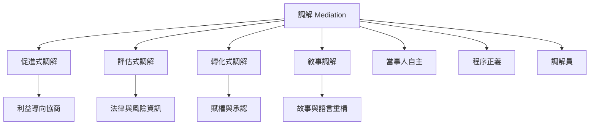

調解方法不是單一技巧，而是對第三方角色、當事人自主、衝突本質與程序目標的不同理解。促進式方法著重讓當事人自行協商；評估式方法較可能提出風險分析；轉化式方法關注賦權與承認；敘事方法則處理支配衝突的故事與語言。實務上可以混合使用，但應清楚告知角色變化。

建議閱讀：先讀[[調解（Mediation）]]與[[當事人自主]]，再比較各調解模式；接著讀[[調解應同時辨識立場利益關係與結構]]與[[調解員中立不能等同於對不平等保持沉默]]，避免只把方法理解成提問技巧。

## 思與行
* 選一個真實但低風險的衝突情境，分別用促進式、評估式與轉化式語言設計開場，觀察各自帶出的不同權力效果。
* 對外提供服務時，明確說明調解員將採取哪一種角色、是否會提出評估，以及如何轉換角色。

## 參考
* [[調解經典書目從談判技巧延伸到轉化與批判倫理]]。
* [[Wall等人回顧指出調解研究長期重描述輕理論]]。
