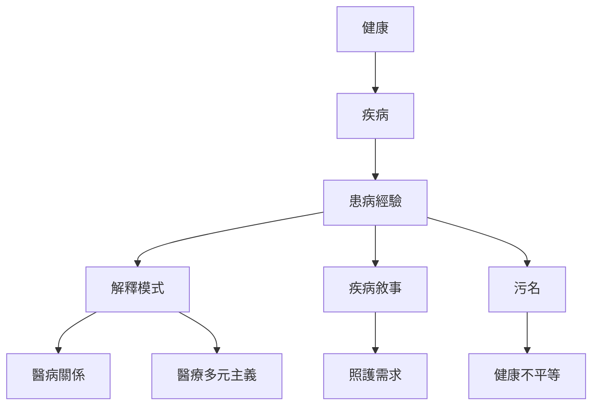

這張地圖從健康、疾病與患病經驗的區分出發，連結患者如何理解、敘述與生活於疾病之中。它提醒研究者：醫學診斷、主觀經驗與社會承認彼此相關但不能互相取代。

## 雙向連結
* [[醫療社會學同時研究健康分布與醫療制度如何組織生活]]
* [[病人的解釋模式影響疾病意義與治療合作]]
* [[疾病敘事讓醫療看見診斷之外的生命經驗]]
* [[Kleinman 以台灣田野說明疾病經驗具有文化與關係脈絡]]
* [[疾病故事能呈現病人如何重建身分與生活秩序]]
* [[把一次看診當作觀察知識權力如何協商的微型田野]]

## 概念
[[健康]]、[[疾病]]、[[患病經驗]]、[[解釋模式]]、[[疾病敘事]]、[[污名]]、[[醫病關係]]、[[醫療多元主義]]。
