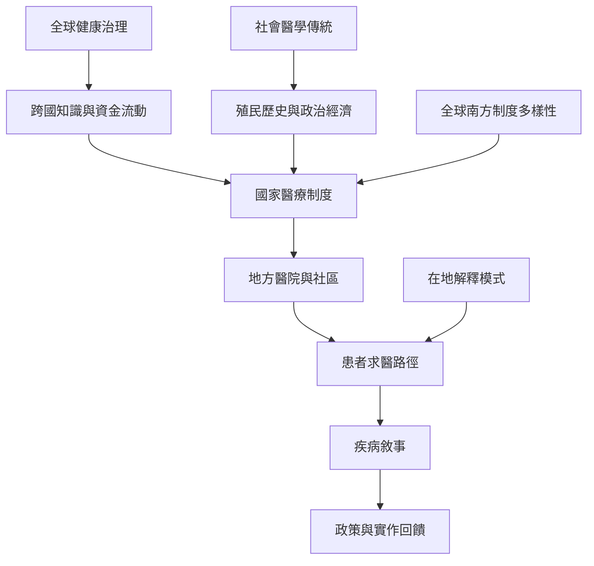

這張地圖把全球健康治理、全球南方制度特性與地方醫療經驗連起來。比較研究必須讓在地案例修正理論，而不是把全球北方制度當作唯一尺度。

## 雙向連結
* [[醫療社會學需要同時分析全球權力與在地疾病經驗]]
* [[全球南方的醫療制度不能只用全球北方分類理解]]
* [[非洲醫療社會學將經典理論放入在地醫療現實檢驗]]
* [[拉丁美洲社會醫學提供從政治經濟理解健康的另一條傳統]]
* [[醫院不只是治療場所也是社會秩序的縮影]]
* [[比較同一疾病在不同社會中的求醫路徑與生活意義]]

## 概念
[[醫療社會學]]、[[醫療多元主義]]、[[社會健康決定因素]]、[[結構性暴力]]、[[全民健康覆蓋]]。
