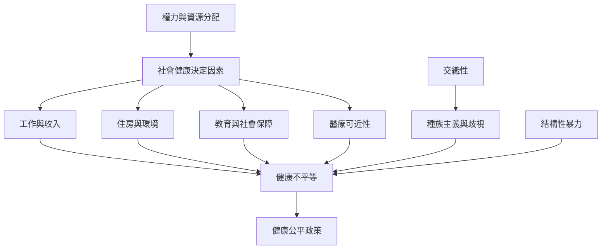

這張地圖呈現社會條件如何透過資源分配、制度權力與日常暴露影響健康。分析時應從個人風險往上追溯至工作、住房、政策、歧視與跨國結構。

## 雙向連結
* [[健康不平等是社會資源與權力不平等的身體化結果]]
* [[健康公平不能只以醫療服務覆蓋率衡量]]
* [[結構性暴力使社會不平等以疾病與早逝的形式出現]]
* [[交織性分析能看見多重社會位置如何共同形成健康差距]]
* [[讓患者共同決定疾病故事如何被保存與公開]]
* [[世界衛生組織指出健康不平等源自權力與資源分配]]

## 概念
[[社會健康決定因素]]、[[健康不平等]]、[[健康公平]]、[[交織性]]、[[結構性暴力]]、[[全民健康覆蓋]]、[[社會模式的身心障礙觀]]。
