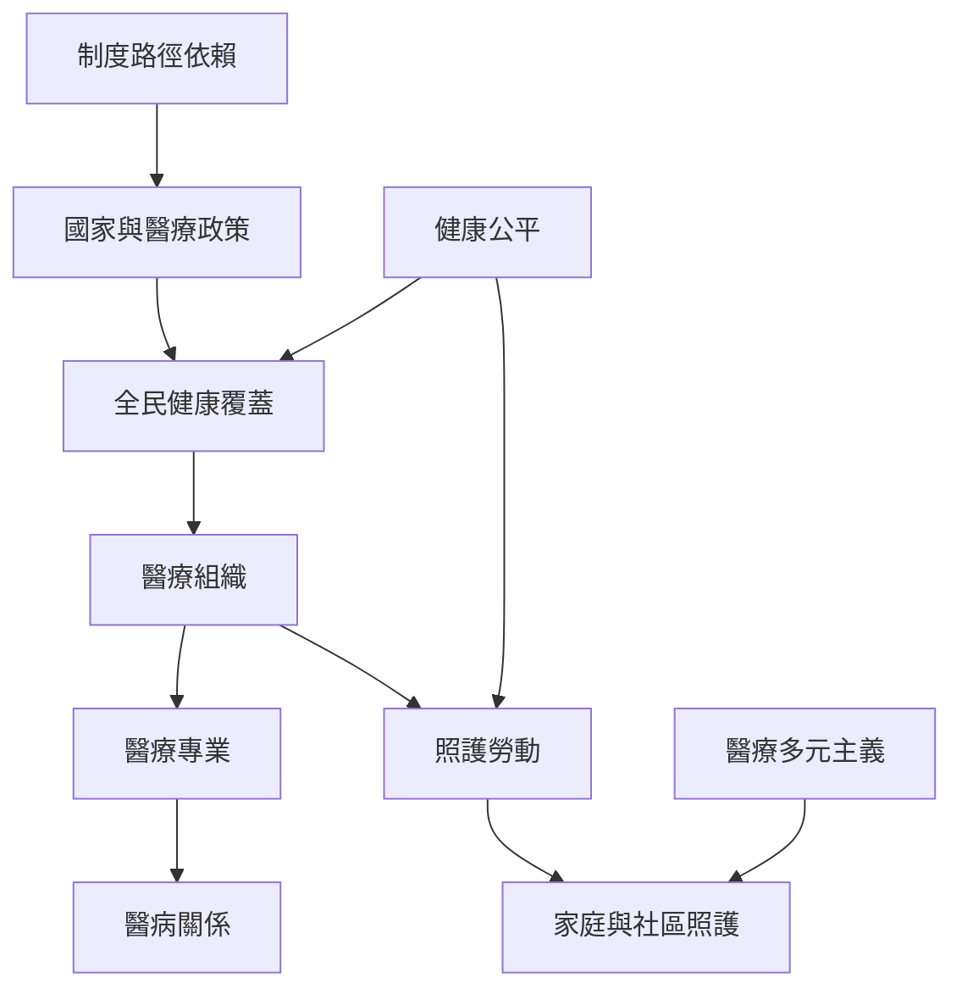

這張地圖將醫療制度視為一組歷史形成的組織與關係：國家政策、保險制度、醫院、專業分工、家庭照護與社區支持彼此依賴，也彼此分配權力與成本。

## 雙向連結
* [[台灣全民健保的普及性來自歷史制度整合而非單一政策決定]]
* [[台灣全民健保既是風險分攤制度也是社會團結制度]]
* [[醫院不只是治療場所也是社會秩序的縮影]]
* [[醫療專業權威會透過組織分工與知識控制形成]]
* [[照護勞動是醫療體系得以運作卻常被低估的基礎]]
* [[把家庭照顧時間納入醫療制度的真實成本]]

## 概念
[[全民健康覆蓋]]、[[制度路徑依賴]]、[[醫病關係]]、[[醫療多元主義]]、[[照護勞動]]、[[醫療社會學]]。
