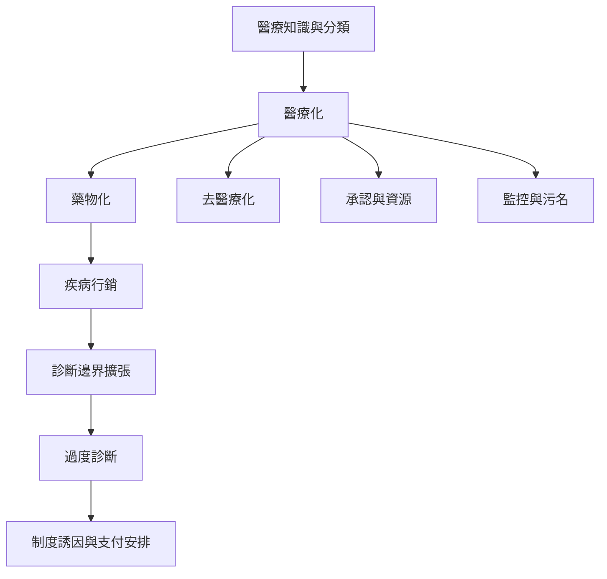

這張地圖聚焦疾病分類與醫療知識如何擴展、如何被市場與制度使用，以及患者如何回應。醫療化、藥物化、疾病行銷與過度診斷是彼此相關但不能混為一談的分析概念。

## 雙向連結
* [[醫療化會重新分配問題定義權與處置權]]
* [[醫療化有時帶來承認與資源有時也會擴張控制]]
* [[藥物化使健康問題更容易被轉譯成藥物市場]]
* [[疾病行銷透過擴張疾病邊界創造需求]]
* [[過度診斷是制度誘因與文化期待共同形成的結果]]
* [[設計疾病宣傳的公共查核卡以分辨證據與行銷]]

## 概念
[[醫療化]]、[[去醫療化]]、[[藥物化]]、[[疾病行銷]]、[[過度診斷]]、[[病人角色]]。
