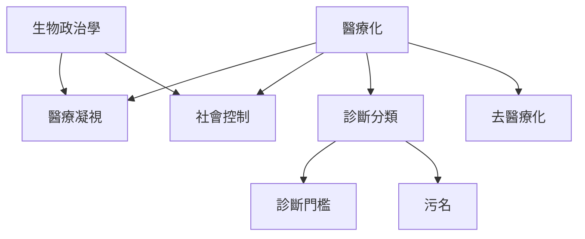

醫療化是理解現代社會如何命名、管理與照護身心經驗的重要概念。這張地圖整理概念源流、專業權力、正常性與分類變動。閱讀時可從[[醫療化]]進入，再連結[[醫療凝視]]、[[生物政治學]]與[[社會控制]]，最後比較[[去醫療化]]如何改變分類。

## 思與行
* 將經典理論與具體案例對讀，避免只記住概念名稱。
* 思考一個分類在什麼條件下能保護人、又在什麼條件下限制人。

## 參考
* [[醫療化是把人類經驗重新界定為醫療問題的社會過程]]、[[醫療化不等於過度醫療因為承認與控制可能同時發生]]、[[診斷分類具有制度性與歷史性]]。
* [[醫療化概念需要同時保留歷史性與多方向性]]、[[精神疾病批判提醒診斷也涉及生活處境與倫理判斷]]。
