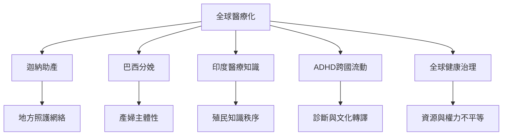

全球視角不應將歐美醫療制度當成普遍標準。醫療化在不同地方與國家政策、家庭照護、傳統醫療、殖民歷史、宗教文化及全球市場互動，並產生不同形式的採納、混合與抵抗。

## 思與行
* 跨國比較必須區分診斷定義、醫療可近性、在地文化與制度資源。
* 研究地方療癒知識時，同時尊重文化脈絡並清楚評估安全與療效證據。

## 參考
* [[醫療化在不同社會中以不均勻方式發生]]、[[醫療多元主義提醒研究者不要把地方照護視為落後]]、[[全球健康知識需要檢視跨國權力關係]]。
* [[迦納鄉村助產研究呈現國家醫療化與地方照護並存]]、[[印度殖民醫學史呈現不同知識體系如何爭奪正當性]]、[[ADHD跨國研究指出診斷類別會隨制度與文化移動]]。
