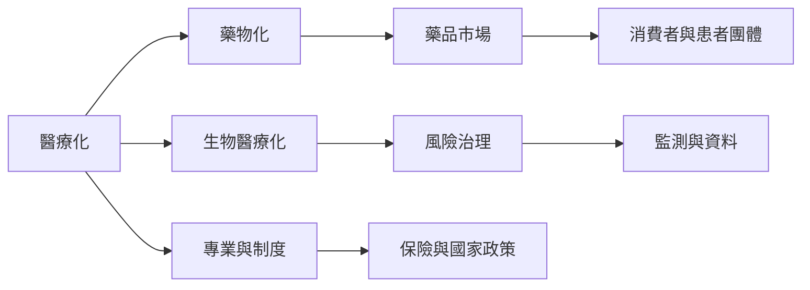

醫療化由專業制度、國家治理、支付系統、產業、媒體與患者行動者共同推動。當生物醫學科技深入日常生活，分析焦點也從疾病管轄擴展到風險監測、資料管理與身體改造。

## 思與行
* 以一個診斷或健康科技為例，追蹤從研究、分類、推廣到日常使用的完整鏈條。
* 特別標示患者倡議與商業行動者的不同角色，不假設其利益必然一致。

## 參考
* [[醫療化是多方行動者共同推動的過程]]、[[疾病市場受到商業與治理制度共同塑造]]、[[生物醫療化把健康轉化為科技監測與身體改造]]。
* [[藥物化框架說明人的能力與狀態如何成為藥物介入市場]]、[[為醫療科技建立低監控的健康使用原則]]。
