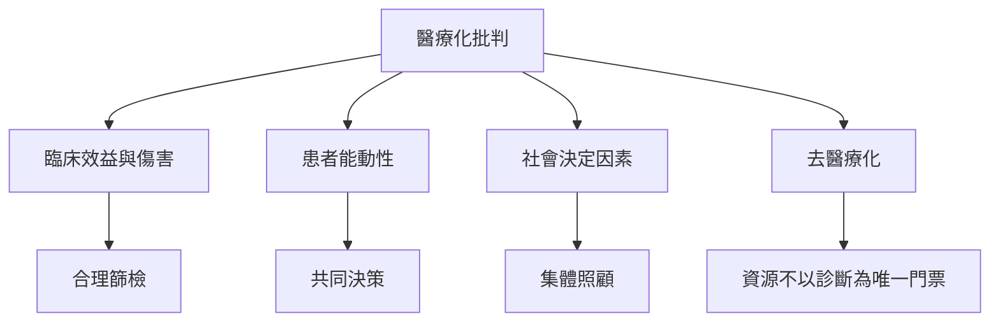

對醫療化的批判不能停留在反醫療，而應區分必要治療、過度診斷、分類污名與結構性問題。替代實踐包括共同決策、患者敘事、社區支持、社會決定因素介入、去病理化與更低監控的健康科技。

## 思與行
* 以「擴大選擇」取代「醫療或非醫療」的二分法。
* 發展不必先取得診斷才能進入的支持，同時保留專業醫療資源。

## 參考
* [[醫療化不等於過度醫療因為承認與控制可能同時發生]]、[[患者能動性是醫療決策的重要部分]]、[[照護自主性需要與醫療安全一起討論]]。
* [[建立一份醫療化個案檢核表以避免非黑即白的判斷]]、[[共同設計不以診斷為門票的社區支持]]、[[把去病理化與資源保障一起設計才能減少分類兩難]]。
