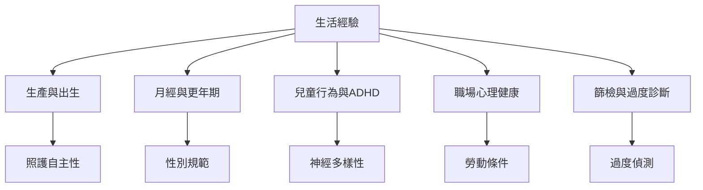

醫療化不只出現在診間，也出現在生產、月經、更年期、兒童行為、工作壓力、老化與篩檢。這些案例讓我們觀察分類如何和性別、年齡、工作規範、照顧責任與患者主體性連在一起。

## 思與行
* 每個案例都問：醫療介入是否回應當事人需求？是否同時改變了權力與責任分配？
* 優先閱讀當事人敘事，再閱讀政策或專業統計，以免只見制度而不見生活。

## 參考
* [[性別化身體更容易被規訓為醫療對象]]、[[生命階段如何成為醫療分類取決於歷史脈絡]]、[[神經多樣性把差異重新放回權利與環境脈絡]]。
* [[巴西分娩研究指出產科醫療化需要恢復產婦主體性]]、[[日本職場憂鬱研究展示社會問題如何透過診斷被個人化]]、[[韓國甲狀腺癌篩檢研究區分過度偵測與真實疾病負擔]]。
