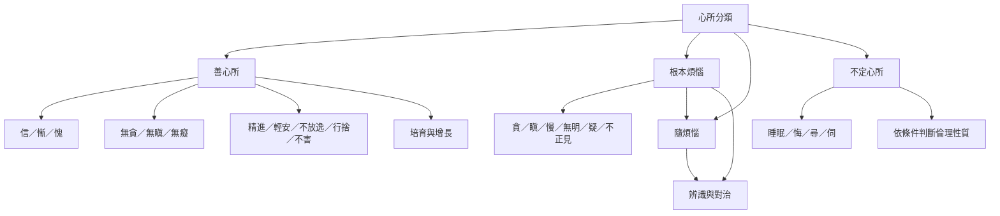

心所分類不只描述認知，也刻畫心理活動的倫理方向與修道功能。瑜伽行派常見的六位分類，把善的心理品質、根本煩惱、隨煩惱與不定因素放在同一張地圖中；不同傳統的計數與分組方式仍須各自標示。

概念互讀：[[心所]]、[[信]]、[[無貪]]、[[無瞋]]、[[無癡]]、[[慚]]、[[愧]]、[[精進]]、[[輕安]]、[[平等捨]]、[[貪]]、[[瞋]]、[[癡]]、[[根本煩惱]]、[[隨煩惱]]、[[不定心所]]。

延伸閱讀：[[善心所指向無害清明而不只是愉快情緒]]、[[根本煩惱描述染污心的主要模式]]、[[不定心所顯示心理活動的倫理功能依情境而變]]。

[[Mental_factors]]
