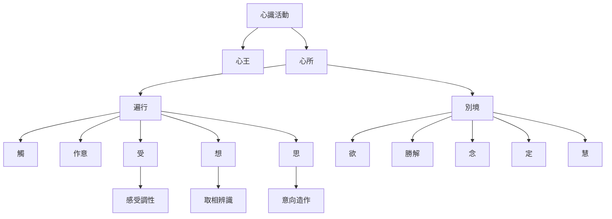

心所是依心而起、與心相應的心理作用。理解其結構時，可先以心王與心所的關係為入口，再看遍行與別境如何描述認知事件的基本條件與特定投入方式。五遍行的組合提供分析架構，而非要求經驗依照固定順序運行。

概念互讀：[[心所]]、[[心王]]、[[遍行]]、[[別境]]、[[觸]]、[[受]]、[[想]]、[[思]]、[[作意]]、[[欲]]、[[勝解]]、[[念]]、[[定]]、[[慧]]。

可與[[五遍行構成心識經驗的基本條件]]、[[別境心所描述心對特定所緣的投入方式]]及[[觸受想思作意構成認知活動的互補面向]]互相參照。

[[Mental_factors]]
