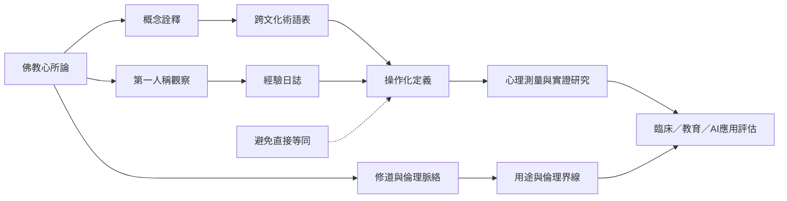

心所與現代心理學可能在注意、感受調性、記憶、意向與認知評估等方面形成對話，但術語不能直接一對一對譯。跨學科工作須先尊重各自的理論脈絡，再建立清楚的操作定義與證據層級。

概念互讀：[[心所]]、[[作意]]、[[受]]、[[思]]、[[念]]、[[定]]、[[慧]]。

研究互讀：[[心所與現代心理學構念只能局部對照]]、[[佛教心理學研究必須區分理論潛力與臨床證據]]、[[以第一人稱經驗日誌檢查心所分類的解釋力]]、[[以心所分類設計AI代理的狀態描述但不擬人化]]。

[[Mental_factors]]
