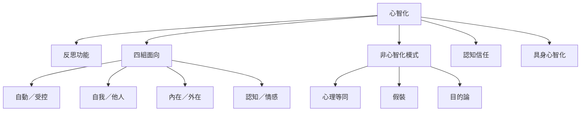

本地圖整理心智化的定義、發展條件、運作面向與失衡形式。閱讀時先抓住核心：心智化是在不確定中理解心理狀態，並在情境變化時彈性切換不同面向。

## 思與行
* 閱讀順序：先定義，再理解四組面向，最後比較三種非心智化模式與認知信任。
* 每次使用模型時先確認它是研究分類、臨床語言還是日常自我觀察工具。

## 參考
* [[心智化是把行為理解為心理狀態表達的能力]]、[[有效心智化仰賴四組面向的彈性平衡]]、[[三種非心智化模式描述反思能力中斷的不同樣態]]、[[認知信任使社會訊息有機會成為可學習的知識]]。
* 概念：[[心智化]]、[[反思功能]]、[[心智化失衡]]、[[過度心智化]]。
