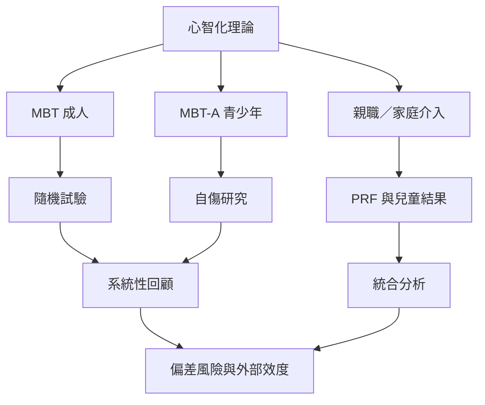

本地圖整理心智化理論如何轉化成 MBT、青少年與親職介入，以及不同研究層級的證據限制。閱讀時必須區分理論合理性、臨床可行性與高品質療效證據。

## 思與行
* 先查目標族群與方案，再判讀試驗和統合分析，不用一個族群的研究替另一群體背書。
* 將研究限制和臨床選擇並列，尊重專業但不放棄證據透明。

## 參考
* [[心智化治療把理解心理狀態放在治療關係中心]]、[[二〇二五年回顧將成人邊緣型人格障礙的 MBT 隨機試驗擴增至十四項]]、[[二〇二六年親職心智化介入回顧仍未確認反思功能的穩定療效]]。
* 概念：[[心智化治療]]、[[青少年心智化治療]]、[[父母反思功能]]、[[心智化測量]]。
