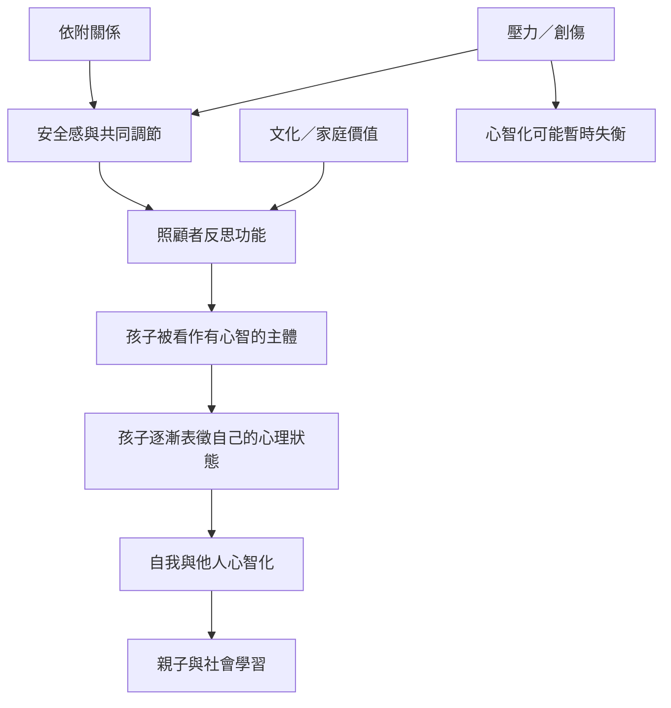

本地圖聚焦心智化如何在早期照顧、依附與家庭互動中發展，以及父母反思功能如何支持兒童把自己和他人理解為具有心智的主體。

## 思與行
* 不把依附模型解讀為母親單因論，應同時考量其他照顧者、家庭、社群與制度支援。
* 將父母反思功能放在照顧者福祉、資源與文化脈絡中理解。

## 參考
* [[依附關係中的照顧者反思功能支持兒童形成心理自我]]、[[父母的反思功能把孩子視為具有獨立心智的主體]]、[[高喚起狀態會使反思空間縮小]]。
* 概念：[[依附理論]]、[[安全依附]]、[[父母反思功能]]、[[成人依附訪談]]。
