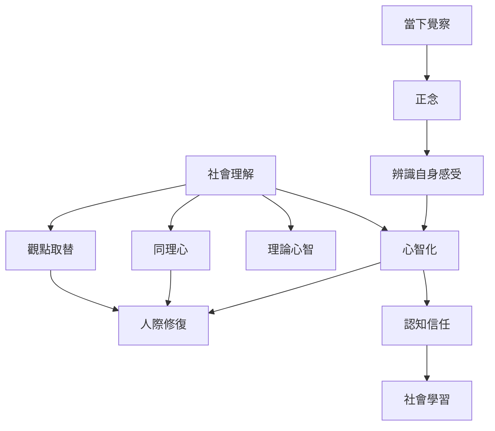

本地圖比較心智化與相鄰構念，並連接治療關係、認知信任與日常溝通。概念彼此交疊，但應依其研究定義與實際任務區分。

## 思與行
* 依任務選用概念：先觀察身體經驗、再辨識情緒、再理解雙方觀點，最後共同核對。
* 不用同理或正念分數代替心智化測量，也不把所有社會理解視為同一能力。

## 參考
* [[心智化不是理論心智或同理心的完全同義詞]]、[[正念與心智化互補但不相等]]、[[治療關係中的心智化與認知信任共同促進社會學習]]。
* 概念：[[正念]]、[[同理心]]、[[理論心智]]、[[認知信任]]、[[觀點取替]]。
